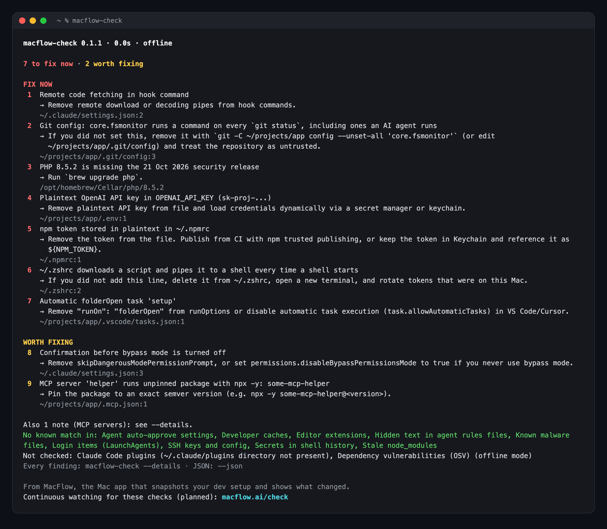

# macflow-check

[](https://github.com/mazharul/macflow-check/releases/latest) [](LICENSE) 

**Find the settings on your Mac that let an AI agent, a cloned repo or a package run code or read your keys.**

Coding agents run `git`, `npm` and shell commands in repos you did not write. What actually runs is decided by a handful of config files: a hook in `.claude/settings.json`, an MCP server started with `npx -y`, a `core.fsmonitor` line in a repo's git config, a `curl | sh` in `.zshrc`, a token left in `~/.npmrc`. macflow-check reads those files and lists what to fix first.

- **Read-only.** It never changes a file, never runs a program it finds, and never prints a secret: findings name the file, line and kind of value only.
- **Local.** The only network call sends package names and versions to [OSV](https://osv.dev). `--offline` turns it off.
- **One binary.** No account, no config, no telemetry.



<sub>A demo home folder with planted problems. The PHP finding is real: that Mac was a release behind.</sub>

## Install

```sh
brew install mazharul/tap/macflow-check
macflow-check
```

Releases are universal binaries for Apple silicon and Intel Macs. Without Homebrew, download, verify the SHA-256 and install to `~/.local/bin` (no sudo):

```sh
curl -fsSL https://raw.githubusercontent.com/mazharul/macflow-check/main/install.sh | sh
```

or build from source with a recent stable Rust toolchain:

```sh
cargo install --git https://github.com/mazharul/macflow-check
```

## What you get

- **Fix now** (red) and **worth fixing** (yellow), numbered, most urgent first. Each line has a fix and the file and line to change.
- Findings of the same kind collapse into one line with a count. `macflow-check --show 3` lists every finding in group 3.
- **Disk space** lists caches and stale `node_modules` you can reclaim, with the command for each.
- The footer says which checks found nothing and which could not run. "No known match" means none of the checks below matched. It does not mean nothing is wrong.
- `--details` prints every check and finding; `--json` gives machine-readable output.

```sh
macflow-check            # scan ~/code, ~/projects, ~/dev and ~/src
macflow-check ~/work     # scan a different folder
macflow-check --offline  # no network at all
macflow-check --show 1   # every finding in group 1
```

Colour is on in a terminal and off when the output is piped, with `--no-color`, or when `NO_COLOR` is set.

<details>
<summary>The same report as plain text</summary>

```text
macflow-check 0.1.1 · 0.0s · offline

7 to fix now · 2 worth fixing

FIX NOW
 1  Remote code fetching in hook command
    → Remove remote download or decoding pipes from hook commands.
    ~/.claude/settings.json:2
 2  Git config: core.fsmonitor runs a command on every `git status`, including ones an AI agent runs
    → If you did not set this, remove it with `git -C ~/projects/app config --unset-all 'core.fsmonitor'` (or edit ~/projects/app/.git/config) and treat the repository as untrusted.
    ~/projects/app/.git/config:3
 3  PHP 8.5.2 is missing the 21 Oct 2026 security release
    → Run `brew upgrade php`.
    /opt/homebrew/Cellar/php/8.5.2
 4  Plaintext OpenAI API key in OPENAI_API_KEY (sk-proj-...)
    → Remove plaintext API key from file and load credentials dynamically via a secret manager or keychain.
    ~/projects/app/.env:1
 5  npm token stored in plaintext in ~/.npmrc
    → Remove the token from the file. Publish from CI with npm trusted publishing, or keep the token in Keychain and reference it as ${NPM_TOKEN}.
    ~/.npmrc:1
 6  ~/.zshrc downloads a script and pipes it to a shell every time a shell starts
    → If you did not add this line, delete it from ~/.zshrc, open a new terminal, and rotate tokens that were on this Mac.
    ~/.zshrc:2
 7  Automatic folderOpen task 'setup'
    → Remove "runOn": "folderOpen" from runOptions or disable automatic task execution (task.allowAutomaticTasks) in VS Code/Cursor.
    ~/projects/app/.vscode/tasks.json:1

WORTH FIXING
 8  Confirmation before bypass mode is turned off
    → Remove skipDangerousModePermissionPrompt, or set permissions.disableBypassPermissionsMode to true if you never use bypass mode.
    ~/.claude/settings.json:3
 9  MCP server 'helper' runs unpinned package with npx -y: some-mcp-helper
    → Pin the package to an exact semver version (e.g. npx -y some-mcp-helper@<version>).
    ~/projects/app/.mcp.json:1

Also 1 note (MCP servers): see --details.
No known match in: Agent auto-approve settings, Developer caches, Editor extensions, Hidden text in agent rules files, Known malware files, Login items (LaunchAgents), SSH keys and config, Secrets in shell history, Stale node_modules
Not checked: Claude Code plugins (~/.claude/plugins directory not present), Dependency vulnerabilities (OSV) (offline mode)
Every finding: macflow-check --details · JSON: --json

From MacFlow, the Mac app that snapshots your dev setup and shows what changed.
Continuous watching for these checks (planned): macflow.ai/check
```

</details>

## Why these checks

Each check follows a published incident or advisory:

| Incident | Check |
| --- | --- |
| Claude Code project files committed to a repo that ran code and leaked API tokens ([Check Point, CVE-2025-59536](https://research.checkpoint.com/2026/rce-and-api-token-exfiltration-through-claude-code-project-files-cve-2025-59536/)) | Agent auto-approve settings |
| A repo's git config running a program when an agent runs `git status` ([VulnCheck](https://www.vulncheck.com/advisories/hermes-agent-rce-via-git-core-fsmonitor-config-injection), [Copilot CLI GHSA-9ccr-r5hg-74gf](https://github.com/github/copilot-cli/security/advisories/GHSA-9ccr-r5hg-74gf)) | Git config that runs commands |
| Invisible Unicode instructions in agent rules files ([Pillar Security](https://www.pillar.security/blog/new-vulnerability-in-github-copilot-and-cursor-how-hackers-can-weaponize-code-agents)) | Hidden text in agent rules files |
| Malicious npm releases that collected tokens from dotfiles ([Datadog on Shai-Hulud 2.0](https://securitylabs.datadoghq.com/articles/shai-hulud-2.0-npm-worm/), [Nx s1ngularity postmortem](https://nx.dev/blog/s1ngularity-postmortem)) | Plaintext credentials |
| Compromised editor extension releases ([StepSecurity on Nx Console](https://www.stepsecurity.io/blog/nx-console-vs-code-extension-compromised), [Socket on GlassWorm](https://socket.dev/blog/glassworm-loader-hits-open-vsx-via-suspected-developer-account-compromise)) | Editor extensions, Known malware files |
| A malicious MCP package that persisted through a LaunchAgent ([SafeDep](https://safedep.io/malicious-copilot-mcp-apex-npm-macos-infostealer/)) | Login items (LaunchAgents) |
| Stealers persisting in shell startup files and reading shell history ([Hackread on AMOS](https://hackread.com/amos-stealer-macos-keychain-files-browser-passwords/), [Wiz on LiteLLM](https://www.wiz.io/blog/litellm-compromised-steals-credentials)) | Shell startup files, Secrets in shell history |

## What leaves your Mac

One thing, and only when you are online: the dependency check sends each lockfile package's name, version and ecosystem to the OSV `querybatch` API (`https://api.osv.dev/v1/querybatch`), using the system `curl`. Nothing else is sent: no file contents, paths, findings, secrets or usage data. `--offline` skips this call, and the report marks that check as not checked.

## What it checks

**AI agent setup**

| Check | What it reports |
| --- | --- |
| Agent auto-approve settings | VS Code, Cursor, Windsurf and VSCodium settings that let the agent run tools, terminal commands or edits without asking, or turn workspace trust off. Codex `sandbox_mode = "danger-full-access"`, `approval_policy = "never"` (including in profiles) and trust given to your whole home folder. A repo's `.claude/settings.json` that auto-enables its MCP servers, redirects API traffic (`ANTHROPIC_BASE_URL`) or sets `apiKeyHelper`. Gemini CLI `auto_edit` approval, folder trust turned off, unrestricted `run_shell_command`, and trust given to your whole home folder in `trustedFolders.json`. Aider `yes-always`, and commands (`test-cmd`, `lint-cmd`, `notifications-command`, `editor`) set in a repo's own `.aider.conf.yml`. |
| Claude Code settings | Hooks that download and run code, hooks that run a script from the repo, `Bash(*)` and other broad permission rules, bypass mode and a skipped bypass confirmation. |
| MCP servers | Every MCP server in Claude, Cursor, Windsurf, VS Code, Gemini CLI and project `.mcp.json` files; servers that run an unpinned package with `npx -y`; credentials written into a server's URL, environment or arguments. |
| VS Code tasks | Tasks set to run when a folder opens (`runOn: folderOpen`). |
| Plaintext AI keys | AI provider keys written into `.env` files. Firebase and Maps keys in browser-facing variables are reported Low; Gemini keys never are. |
| Claude Code plugins | Installed and enabled plugins, with the same hook checks as settings. |
| Hidden text in agent rules files | Invisible Unicode (tag characters, bidirectional controls, zero-width characters) in `AGENTS.md`, `CLAUDE.md`, `.cursorrules`, Copilot instructions, skills and similar files. Reports code points and lines, never the text. |

**Security**

| Check | What it reports |
| --- | --- |
| Git config that runs commands | Settings in a repo's own config that run a program on everyday git commands: `core.fsmonitor`, pagers, editors, filters, diff and merge drivers, `sshCommand` with extra options, credential helpers outside system folders, shell aliases, hook folders the repo ships, and `ext::` remotes. Global config is checked too, at Medium. Includes worktrees, submodules, nested bare repos and included config files. |
| SSH keys and config | Unencrypted private keys, `StrictHostKeyChecking no`, `UserKnownHostsFile /dev/null`, agent forwarding to every host, commands run from temporary folders, and `command=` entries in `authorized_keys`. |
| Plaintext credentials | Literal secrets in `~/.npmrc`, `~/.yarnrc.yml`, `~/.pypirc`, `~/.gem/credentials`, `~/.cargo/credentials(.toml)`, `~/.git-credentials` (High) and `~/.netrc`, `pip.conf`, GitHub CLI `hosts.yml` (Medium). Also at Medium: Docker registry logins not kept in a credential store, AWS long-term (`AKIA`) access keys, Google Cloud user credentials, static Kubernetes tokens and client keys (clusters on this Mac and exec plugins are skipped), and the Codex, Gemini CLI and Claude Code login files (existence only). |
| PHP runtime | PHP installs from Homebrew, MAMP, asdf, mise and phpenv that are behind the latest security release or on a branch that no longer gets fixes. Versions are read from folder names; no PHP binary is run. |
| Editor extensions | Extension versions named in published compromise reports, and extensions installed from a local `.vsix` file instead of the marketplace (Medium), in VS Code, VS Code Insiders, VSCodium, Cursor and Windsurf. |
| Known malware files | Files the Nx Console backdoor drops on macOS. |
| Login items (LaunchAgents) | User LaunchAgents that start a program from a temporary folder, download and run a script, open a browser debugging port, or re-run every minute or more often. Known vendors are skipped. |
| Dependency vulnerabilities (OSV) | Packages in `package-lock.json`, `Pipfile.lock` and `composer.lock` with known vulnerabilities or known malicious releases, from [OSV](https://osv.dev). |
| Shell startup files | Lines in `.zshrc`, `.zshenv`, `.zprofile`, `.zlogin`, `.bashrc`, `.bash_profile` and `.profile` that pipe a download into a shell, decode and run base64, start a program from a temporary folder, alias `sudo` to something else, or set an AI agent to approve everything (`GEMINI_CLI_TRUST_WORKSPACE=true`, `gemini --yolo`, `aider --yes-always`). |
| Secrets in shell history | How many lines of `.zsh_history` and `.bash_history` hold tokens or passwords, and of which kinds. Never the values. |

**Garbage**

| Check | What it reports |
| --- | --- |
| Developer caches | Size of Xcode DerivedData, archives and device support files, simulator caches, and npm, Homebrew, pip and Yarn caches, with the command that clears each. |
| Stale node_modules | `node_modules` folders in projects untouched for 90 days or more (judged by git activity), and their size on disk. |

## Usage

```text
macflow-check [OPTIONS] [PATHS]...

    --details        List every check and finding, not the short summary
    --show <N>       Show every finding in group N of the summary
                     (scans again: pass the same paths and --offline)
    --json           Output machine-readable JSON (schema v1)
    --no-color       Plain text (also NO_COLOR=1; CLICOLOR_FORCE=1 forces colour)
    --offline        Skip network checks and run strictly offline
    --root <PATH>    Add a project root directory to scan (repeatable)
    -h, --help       Print this usage message
    -V, --version    Print version information
```

Project checks look in the paths you give (as arguments or `--root`), or by default in `~/code`, `~/projects`, `~/dev` and `~/src`, up to four folders deep. User-level checks always look in your home folder.

Exit codes: `0` when the scan finished, whatever it found; `2` for a bad option; `1` if JSON output could not be written. Use `--json` and read `findings` if you need to fail a script on results.

## Limitations

- macOS only.
- It reads configuration files. It does not look at running processes, network traffic, browser extensions or anything in memory.
- Dependency checks cover `package-lock.json`, `Pipfile.lock` and `composer.lock` only, not `yarn.lock`, `pnpm-lock.yaml`, `Cargo.lock` or `Gemfile.lock`.
- Git config trade-offs: a repo's Husky hook folder (`.husky`, `.husky/_`) is not flagged, though its hooks are code the repo ships; programs under `/usr/local` count as installed, though on Intel Macs that folder is writable without sudo; and every `includeIf` file is checked whatever its condition.
- Every check is a pattern for a known risky setting. A config written to avoid these patterns will get past them.

## Contributing

Issues and pull requests are welcome. Each check lives in its own file under `crates/macflow-scan/src` with its tests next to it. Please add a test that fails without your change, and keep secrets out of fixtures (see `tests/support/fake_keys.rs`). Before opening a PR:

```sh
cargo fmt --all
cargo clippy --workspace --all-targets -- -D warnings
cargo test --workspace
```

To report a vulnerability in macflow-check itself, see [SECURITY.md](SECURITY.md).

## Licence

MIT. See [LICENSE](LICENSE).

---

macflow-check is made by [MacFlow](https://macflow.ai/check), a Mac app that snapshots your dev setup and shows what changed. Continuous watching for these checks is planned.
